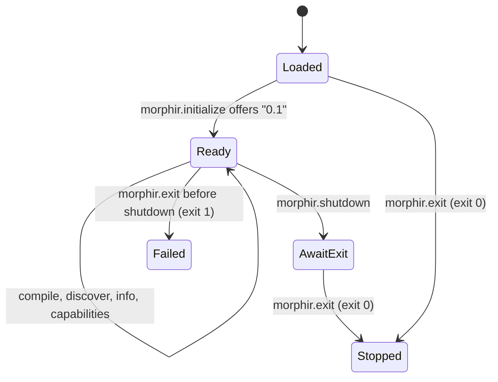

# Elm MEP frontend provider

`morphir-scala-elm` is a Morphir Extension Protocol (MEP) provider: a process that a Morphir CLI host starts and talks
to over standard input and output. It speaks MEP `0.1`, compiles one Elm module per request to Morphir IR v3, and
answers `morphir.workspace.discover` for ad-hoc source selections. The Elm it accepts today is one typed two-argument
`Int` addition function. The [Elm frontend extension design](/design/elm-frontend-extension.md) is the narrative home
for this capability and for [intent 0037](../../intent/0037-morphir-scala-elm-frontend-extension.md).

Baseline: `main` at `4626f467`. Source of truth: `morphir/langkit/elm/compiler/mep` (protocol) and
`morphir/langkit/elm/compiler/ir` (compiler). Run it locally with `./mill morphir.langkit.elm.compiler.mep.jvm.run`.

## Wire and lifecycle

Frames are `Content-Length` headers followed by a UTF-8 JSON-RPC 2.0 body. The decoder refuses a missing, duplicate,
signed or non-numeric `Content-Length`, bounds headers to 64 KiB and bodies to 64 MiB, and reports EOF inside a frame.
Standard output carries frames only. Process errors (framing failures, exit before shutdown) go to standard error with
exit code 1.

**Figure 1:** `SessionState` transitions. `morphir.ping` and `morphir.extension.describe` answer in `Loaded` and `Ready`
without changing state, so a host can read claims and exit without initializing.

| Code | Returned when |
| --- | --- |
| `-32700` | Body is not JSON |
| `-32600` | Malformed envelope, second `morphir.initialize`, `morphir.exit` sent as a request |
| `-32601` | Unknown method in `Ready` |
| `-32602` | Invalid parameters, including a compile request the provider does not support |
| `-32603` | Compiler panic, or compiler output that fails validation or the v3 projection |
| `-32011` | No shared protocol version; `data` lists `hostVersions` and `extensionVersions` |
| `-32014` | Any call other than `initialize`, `describe` or `ping` before initialization; any call after shutdown |

`morphir.extension.describe` returns claims version `0.1.0-draft.2`, protocol versions `["0.1"]`, the extension
identity and these capabilities, all from `internal/ExtensionDefinition.scala`:

| Claim | Value |
| --- | --- |
| `types` | `frontend`, `workspace` |
| `frontend.languages` | `elm`, extension `.elm` |
| `frontend.irVersions` | `["3"]` |
| `frontend.compile` | `true`; `incremental`, `fragments`, `multiDocument` are `false` |
| `workspace` | protocol `0.1.0-draft.1`, `discover: true` |
| `streaming`, `incremental`, `cancellation`, `progress` | `false` |

## Compile requests

`morphir.frontend.compile` takes the `sources` envelope (`sources.documents`, optional string `sources.root`) or the
legacy top-level `documents`. A request with both, or with neither, gets `-32602`. The provider then requires
language `elm`, exactly one document with a non-empty URI, no `dependencies`, `irVersion` `"3"`, `typesOnly` false,
a lower-case package identity such as `local/example`, and one exposed module that matches the source header.

A document `version` is an unsigned 64-bit integer, `0` through `18446744073709551615`. `DocumentVersion` reads it
as an exact integer and rejects negative, fractional and larger values. `MepProtocolTests` pins that range at the
`Structure` level only. That Kyo `1.0.0-RC7` reads a JSON integer above the `Long` range exactly is unverified here:
the design note records a probe outside the test suite, and no repository test sends such a number through JSON.

The compiler accepts one shape and reports every other construct as a compile diagnostic:

| Construct | Accepted | Rejected with |
| --- | --- | --- |
| Module | Plain `module`, explicit exposing of exactly one value | `port`/`effect` (`ELM-IR003`), `(..)`, types, operators (`ELM-IR012`) |
| Imports | None | Any import (`ELM-IR004`) |
| Declarations | Exactly one value declaration | Type aliases, custom types, ports, infix, or several values (`ELM-IR005`) |
| Type | Annotation `Int -> Int -> Int` | Missing annotation or any other type (`ELM-IR006`) |
| Body | `a + b` over the two variable parameters, in order | Any other expression (`ELM-IR007`) or pattern (`ELM-IR008`) |

The compiler lowers that function to the Kyo code model as `Morphir.SDK.Basics.add` over `Morphir.SDK.Basics.Int`.
The MEP layer projects the code model to IR v3 JSON (`formatVersion` 3) and returns `success: true`, `irVersion`,
`ir`, empty `diagnostics`, and `modules`. A failure returns `success: false`, empty `modules` and no `ir`. Each
diagnostic has severity `error`, code `elm.parser` for parse and malformed-header failures or `ELM-IR0nn` otherwise,
and a location with the request URI. Range lines and characters are zero-based, start inclusive, end exclusive.
Characters count UTF-16 code units, the Java string index.

## Workspace discovery

Only the `ad-hoc-sources` purpose is served; `manifest-projects` is refused with `workspace.purpose.unsupported`.
The request's `protocolVersion` must be `0.1.0-draft.1`. An explicit name comes from the overlay's `project.name`,
in Elm or Morphir spelling (`My.Package`, `my/package`), and the snapshot reports its normal form. An unnamed
selection must hold one source and is named `local/<module, lower-cased, dots as dashes>`. A module name comes from
the lexically read header, then the file stem, then `Main`. The checks, refusal codes and messages port morphir-rust
`discover_with_identity` and morphir-elm `cli2/mep/workspace.ts`, as the source comments record.

## Distribution

GitHub Releases on a root `v*` tag carry one GraalVM Native Image executable per platform (`mac-aarch64`,
`mac-amd64`, `linux-amd64`, `linux-aarch64`, `win-amd64`), each with a `.sha256` sidecar, plus `checksums.txt`.
There is no Windows ARM64 or JVM package. Releases also carry `morphir-scala-elm-<version>.bundle.release.json`, a
descriptor with `schemaVersion` `2.0.0-draft.2` listing each artifact's target triple, filename, SHA-256 and the
same claims `describe` returns. The 0.5.0-M10 changelog says publishing that bundle needs Morphir CLI
`0.4.0-beta.7` or later; nothing in this repository checks that version. Build and release tasks are in
[Packaging and Release](/packaging-and-release.md).

## Verification and current limits

`morphir.langkit.elm.compiler.mep.jvm.test` covers framing, lifecycle, envelopes, discovery and diagnostics.
`ElmToMorphirIRCompilerTests` checks the Kyo code model for the add function and the rejected constructs.
`nativeImageSmoke` runs the built executable through describe, initialize, info, capabilities, discovery, one valid
and one invalid compile, and shutdown. On a valid compile, both suites check `success`, `irVersion`, `modules` and
that `ir` is an object; the session test also checks `formatVersion` 3. No test validates the IR against a schema or
compares it with `morphir-elm`. The finos/morphir `elm_extension` host suite named in the design does not run in
this repository's CI. Whether the released binary passes it is unverified here.

Morphir IR equivalence with `morphir-elm` is not defined or measured. Both it and the host suite are open acceptance
criteria of the [Elm frontend extension Design Note](/design/elm-frontend-extension.md#acceptance), tracked by
[intent 0037](../../intent/0037-morphir-scala-elm-frontend-extension.md).
