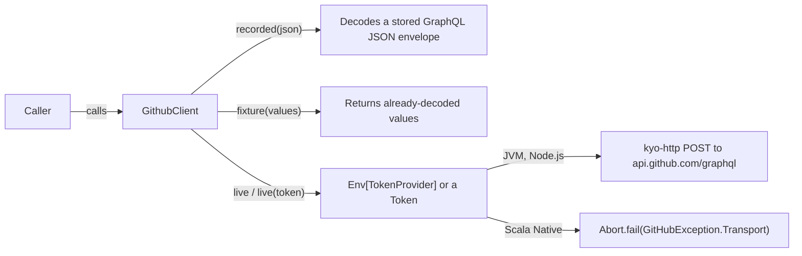

# GitHub GraphQL Connector

`org.finos.morphir::morphir-connector-github` is a read-only Kyo client for GitHub's GraphQL API. It lists and looks up
repository issues, pull requests and discussions, user gists, and the comments and replies under them. Every operation
returns a Kyo effect that can fail with `GitHubException`. The live client posts to `https://api.github.com/graphql` on
the JVM and on Node.js. On Scala Native the same API exists, but every live call fails with
`GitHubException.Transport`. The module carries no Morphir types. It belongs to the connector family whose narrative
home is the [published library families](/design/published-library-families.md) Design Note, and it delivers
[intent 0020](../../intent/0020-github-graphql-connector.md).

## Baseline

Verified against commit `4626f467` (Kyo 1.0.0-RC7). Module source: `morphir/connector/github`, package
`morphir.connector.github`. All three platform variants extend `MorphirPublishModule` ([build](https://github.com/finos/morphir-scala/blob/4626f4676e3b30f92adc4791fc69c6920277e28d/morphir/connector/github/package.mill.yaml)),
with artifact ids `morphir-connector-github_3`, `morphir-connector-github_sjs1_3` and
`morphir-connector-github_native0.5_3`. Only the JVM artifact is on Maven Central (0.5.0-M05 through 0.5.0-M10). The
Scala.js and Scala Native artifacts are built and uploaded on release but have never reached Central; their POMs
name the versionless Kyo dependencies as JVM artifacts with no version. Until a fixed release ships, use them from a
local build. [Intent 0020](../../intent/0020-github-graphql-connector.md) tracks the gap.

## Clients

`GithubClient` has three constructors ([source](https://github.com/finos/morphir-scala/blob/4626f4676e3b30f92adc4791fc69c6920277e28d/morphir/connector/github/src/morphir/connector/github/GithubClient.scala)).
Each one implements the same trait, so calling code does not change between tests and production (see Figure 1).

**Figure 1:** only the live constructor touches the network, and only on the JVM and Node.js.

| Platform | `GithubClient.live` | `TokenProvider.gitHubCli` |
| --- | --- | --- |
| JVM | POSTs through `kyo-http` | Spawns `gh`; tested |
| Scala.js | POSTs through `kyo-http` on Node.js; the module is linked as `CommonJSModule`; no browser backend | Same shared code; spawn untested on Node (unverified) |
| Scala Native | Every call fails with `Transport("Live GitHub HTTP is not linked on Scala Native at kyo 1.0.0-RC7")` | Same shared code; spawn untested on Native (unverified) |

The Native variant does not depend on `kyo-http`. The published `kyo-net` 1.0.0-RC7 Native artifact ships a throwing
kqueue binding, so no I/O backend is available to it ([source](https://github.com/finos/morphir-scala/blob/4626f4676e3b30f92adc4791fc69c6920277e28d/morphir/connector/github/native/src/morphir/connector/github/internal/PlatformLive.scala)).
`GitHubTokenVerifier.live` fails the same way on Native. [Intent 0041](../../intent/0041-live-github-http-on-scala-native.md)
tracks live HTTP on Native.

## Operations

| Scope | Lists (`ConnectionPage[A]`) | Looks up (`Maybe[A]`) |
| --- | --- | --- |
| Repository (`RepositoryRef`) | `listIssues`, `listPullRequests`, `listDiscussions` | `getIssue`, `getPullRequest`, `getDiscussion` |
| Comments | `listIssueComments`, `listPullRequestComments`, `listDiscussionComments`, `listDiscussionReplies` | |
| Gists (`GithubLogin`, `GistName`) | `listGists` (public only), `listMyGists(GistPrivacy)`, `listGistComments` | `getGist`, `getMyGist` |

A lookup returns `Absent` when GitHub returns null. Discussion calls take a `ReplyDepth` (default `ReplyDepth.one`;
`ReplyDepth.none` omits replies). `getGist` and `getMyGist` select up to 300 files and the first comment page.
`GitHubTokenVerifier` reads the authenticated viewer's login as a `GitHubLogin`, a separate type from the gist
`GithubLogin`.

Paging uses `ConnectionPage(nodes, hasNextPage, endCursor)`. A caller passes `endCursor` back as `after: Maybe[Cursor]`,
and a `PageSize` as `first`. `PageSize.parse` accepts 1 to 100, and `PageSize.default` is 100. Issue, pull request and
discussion numbers are distinct opaque types (`IssueNumber`, `PullRequestNumber`, `DiscussionNumber`), so one cannot
be passed where another is expected. `GithubNumber` is the union of all three.

The opaque identifiers and `GitHubException` have `Render` instances that print forms such as `issue:975` and
`cursor:c1`. The module README also claims `Render` output for the public model case classes. The source declares no
explicit instance for them, so that claim is unverified here.

## Tokens

`GithubClient.live` with no argument reads `Env[TokenProvider]`. Each provider also has a `...Layer` form
([source](https://github.com/finos/morphir-scala/blob/4626f4676e3b30f92adc4791fc69c6920277e28d/morphir/connector/github/src/morphir/connector/github/TokenProvider.scala)).

| Provider | Reads | Fails with `Unauthorized` when |
| --- | --- | --- |
| `TokenProvider.const(token)` | A parsed `Token` | Never |
| `TokenProvider.flags` | `StaticFlag` `morphir.connector.github.token` (env `MORPHIR_CONNECTOR_GITHUB_TOKEN`) | The flag is blank |
| `TokenProvider.gitHubActions` | Process env `GITHUB_TOKEN` | The variable is blank or unset |
| `TokenProvider.gitHubCli(user, hostname)` | Stdout of `gh auth token` | `gh` is missing, cannot start, exits non-zero, or prints a blank token |
| `TokenProvider.vault(service, account)` | `Env[SecretStore]` from `morphir-appkit` | The entry is missing, blank, or the store fails |

No provider falls back to another, and none reads `GH_TOKEN`. `Token.parse` trims its input and rejects blank values.
`Token.toString` prints only a known prefix and the last four characters, or `Token(redacted)` for short values. The
reasoning behind this design is in [GitHub token providers and appkit secrets](/design/github-token-providers-and-appkit-secrets.md).

## Errors

| `GitHubException` case | Raised for |
| --- | --- |
| `Unauthorized` | HTTP 401, and every token-provider failure |
| `Forbidden` | HTTP 403 without rate-limit wording |
| `RateLimited` | HTTP 403 whose detail mentions "rate limit", "secondary rate" or "abuse detection" |
| `GraphQl` | A GraphQL `errors` array, or a recorded envelope that does not decode |
| `Transport` | Any other HTTP status or transport failure, and every live call on Scala Native |

`GitHubException` extends `MorphirException`, so a caller can throw it at a user-facing boundary
([source](https://github.com/finos/morphir-scala/blob/4626f4676e3b30f92adc4791fc69c6920277e28d/morphir/connector/github/src/morphir/connector/github/GitHubException.scala)).

## Transport and schema

Queries come from a `caliban-client` selection API generated from `schema/github-subset.graphql`. That file is a
hand-written subset of GitHub's public schema, checked against [`github/docs` at `4919b704`](https://github.com/github/docs/blob/4919b704c4cee5b6cd41377455b15ed829f83aa2/src/graphql/data/fpt/schema.docs.graphql).
The generated `internal/Client.scala` is checked in and regenerated with
`./mill morphir/connector/github/schema/gen-client.scala`. Responses decode through `kyo-schema` JSON. The endpoint is
fixed to GitHub.com; GitHub Enterprise Server is not supported.

## Testing

The shared suite runs on the JVM, Scala.js and Scala Native. It drives `GithubClient.recorded` and
`GithubClient.fixture` with stored GraphQL envelopes and compares results with kyo-test snapshots under
`morphir/connector/github/test-snapshots/`. The live client is only constructed in tests, never called, so no test
contacts `api.github.com`.
