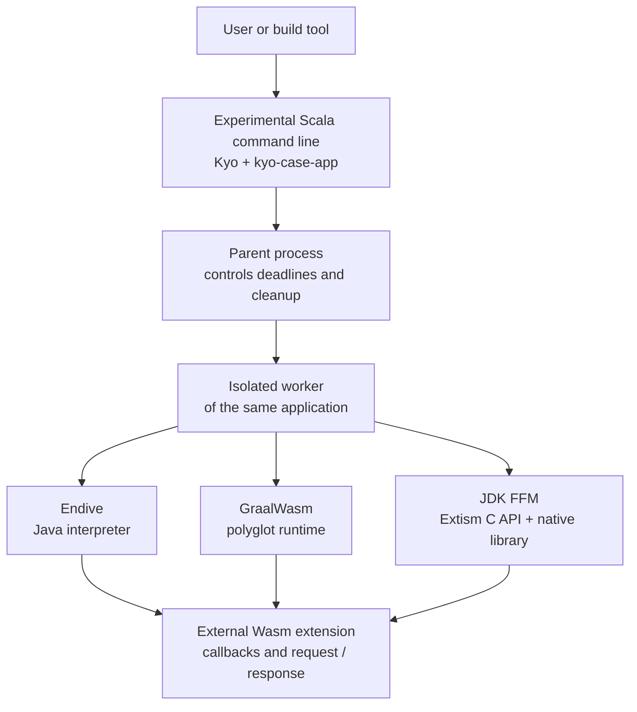
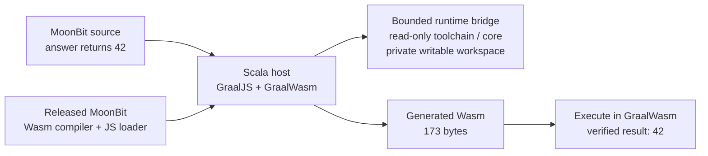

# Can Scala host Morphir Wasm extensions?

> **Exploration only.** This branch preserves research, experimental code and measured reports. It is not intended for direct merge and does not select a production host or replace the Morphir CLI.

**What we learned:** Scala can load and execute external WebAssembly on both the JVM and GraalVM Native Image. Endive and Extism run the tested real SDK/Python extension flows. A separate GraalJS + GraalWasm setup can run the MoonBit Wasm compiler, compile a tiny source file and execute its output, with a documented compatibility workaround. Full Morphir host qualification remains incomplete.

[Exploration branch](https://github.com/finos/morphir-scala/tree/explore/scala-wasm-host) · [Experimental source and commands](https://github.com/finos/morphir-scala/tree/explore/scala-wasm-host/spikes/wasm-host) · [Proposal, design, spec and tasks](https://github.com/finos/morphir-scala/tree/explore/scala-wasm-host/openspec/changes/spike-scala-wasm-host) · [Report files](https://github.com/finos/morphir-scala/tree/explore/scala-wasm-host/spikes/wasm-host/research/reports)

## What are we exploring?

A Morphir host is the application that loads an extension, gives it permitted services and exchanges requests with it. The extension might compile a language or generate output. We want to know whether a Scala host could eventually provide those capabilities, using Kyo for execution and cleanup and kyo-case-app for command processing.

The practical goal is to load separately built extensions without rebuilding the host. We also want a native executable, so we tested the same Scala code on the JVM and through GraalVM Native Image. Scala Native was not a target of this experiment.



## Which approaches worked?

The original matrix uses Endive 1.2.0, GraalWasm 25.0.1 and libextism 1.41.0. Each was tested on the JVM and as a Native Image executable. The newer polyglot compiler proof is a separate experiment.

| Approach | External Wasm and callbacks, JVM / native | Tested real SDK/Python flows | Main qualification finding |
|---|---|---|---|
| Endive interpreter | Pass / pass | Pass / pass | Working bounded-host candidate for the tested profiles; interpreter cost matters |
| GraalWasm | Pass / pass | Refused / refused | Our admission policy requires a memory ceiling; these real guests lack declared maxima and the pinned public API did not supply the required limit |
| Extism through JDK FFM | Pass / pass | Pass / pass | Functional success, but the tested Extism limiter did not enforce the required absolute 256 MiB linear-memory ceiling |

The real flows cover description, negotiation and supported legacy compile/generate work. Endive and FFM also pass eight pinned SDK/Python compatibility-kit guest runs and independent report validation. Those results qualify the tested guest corpus, not every possible Morphir host behavior.

We checked **kyo-ffi first**. Its pinned RC7 code generator rejected a typed callback-pointer declaration, so the spike uses the planned minimal direct JDK FFM fallback. The native library, header, layouts, callbacks, buffer lifetimes and packaging have retained checks.

The real portable Morphir MoonBit guest remains blocked by a compiler/core/dependency mismatch. Synthetic fixtures are not presented as a substitute for that qualification.

## How large are the applications?

Installed application and compressed package sizes, in MiB. JVM rows exclude the external Java runtime, which the inventories account for separately. FFM sizes include libextism. These are the original six delivery configurations, without the later MoonBit compiler payload.

| Configuration | Installed application | Compressed package |
|---|---:|---:|
| Endive JVM | 22.54 | 20.87 |
| Endive Native Image | 28.52 | 11.58 |
| GraalWasm JVM | 40.07 | 24.76 |
| GraalWasm Native Image | 71.73 | 28.33 |
| Extism FFM JVM | 44.89 | 27.73 |
| Extism FFM Native Image | 51.25 | 18.77 |

The footprint report retains **144 runs**, including five fresh-process trials, startup/idle/load/call/cleanup phases, repeated sessions, two-worker observations and 20-cycle parent-retention measurements. Of these, 120 completed and 24 were Graal's real-workload admission refusals. Memory charts retain parent, worker and concurrent aggregate RSS. RSS can count shared pages more than once and does not establish private memory use or prove a leak.

[Footprint charts and lifecycle timelines](https://github.com/finos/morphir-scala/blob/explore/scala-wasm-host/spikes/wasm-host/research/reports/index.html) · [Raw RSS samples](https://github.com/finos/morphir-scala/blob/explore/scala-wasm-host/spikes/wasm-host/research/reports/samples.csv) · [Size inventories](https://github.com/finos/morphir-scala/blob/explore/scala-wasm-host/spikes/wasm-host/research/reports/sizes.json)

## How fast did they run?

There is no single winner across workloads. Here is the Native Image slice of the six-configuration speed matrix. Values are median-of-trial-median milliseconds per checked call, lower is faster.

| Workload | Endive interpreter | GraalWasm | Extism FFM |
|---|---:|---:|---:|
| Callback boundary | 0.0080 | 0.0056 | 0.3303 |
| 100,000 dependent integer steps | 7.8333 | 0.1004 | 0.4269 |
| Eight 64 KiB memory passes | 84.4152 | 0.3238 | 0.7650 |
| Real Python compile request | 7.7092 | Unavailable: admission refused | 0.0598 |

The full matrix retains **120 runs and 11,000 measured calls** across six configurations and four workloads. Each successful trial uses 20 warm-up calls and 100 measured calls, with five fresh trials. Guest bytes and work units match within a workload. Current adapters, callback/copy costs and different runtime metering remain part of the observations. These numbers do not override memory-limit failures or establish performance on other machines.

[All six configurations, percentile tables and speed charts](https://github.com/finos/morphir-scala/blob/explore/scala-wasm-host/spikes/wasm-host/research/reports/speed/index.html) · [Measured-call CSV](https://github.com/finos/morphir-scala/blob/explore/scala-wasm-host/spikes/wasm-host/research/reports/speed/calls.csv)

## Can the host run the MoonBit compiler itself?

**Yes, for the tiny-source proof on JVM and Native Image.** This uses aligned GraalJS/GraalWasm/Polyglot release 25.5.5.0.3 and a digest-verified GraalVM Community JDK. The released MoonBit Wasm compiler is not an ordinary Morphir extension or standalone WASI command, so it needs a separate JavaScript runtime and bounded workspace bridge.



The unmodified loader hits a GraalJS callback failure when the same imported function name appears with decreasing argument counts. A minimal regression reproduces that failure on both targets. The tested workaround gives each import a unique name and forwards the same callback. Receipts preserve original/adapted hashes and verify every non-import section is unchanged.

| Tiny compiler proof | JVM | Native Image |
|---|---:|---:|
| Compile source and execute generated Wasm | Pass | Pass |
| Second source returns 43, unchanged host executable | Pass | Pass |
| Installed host application | 92.09 MiB | 129.59 MiB |
| Compressed host package | 49.20 MiB | 57.36 MiB |
| Fresh process to verified result, median | 1.902 s | 0.637 s |
| Sampled peak RSS, median | 973.23 MiB | 316.14 MiB |

Both need an additional shared compiler/core/license payload of **15.78 MiB installed**, or **3.33 MiB compressed**. The JVM also needs the separately inventoried **633.62 MiB JDK**. Native Image's build took about one minute and peaked at 6.26 GiB RSS; that is build memory, not runtime memory.

This separate proof retains 12 positive/negative checks and 20 timing/RSS trials. It checks invalid source, diagnostics, GC callbacks, UTF-8, exception tags, denied workspace operations including a symlink escape, and file cleanup. Each target has five fresh timing trials without RSS sampling/holds and five separate sampled trials with 200 ms phase holds. Phase/heap observations remain enabled in both. The compiler runs in one process with no worker. Native moonc and Node were not substituted.

This does **not** yet qualify all JavaScript string builtins, multi-file/core compilation, warm compiler throughput, long-lived compiler sessions, cancellation or compiler-session isolation.

[Compiler charts, timelines and checks](https://github.com/finos/morphir-scala/blob/explore/scala-wasm-host/spikes/wasm-host/research/reports/polyglot-compiler/index.html) · [Compiler receipt and measurements](https://github.com/finos/morphir-scala/blob/explore/scala-wasm-host/spikes/wasm-host/research/reports/polyglot-compiler/receipt.json)

## Outcomes and remaining decisions

| Question | Outcome |
|---|---|
| Can Scala load external Wasm after the host is built? | Yes, on JVM and Native Image for all three tested approaches |
| Can we use Kyo and kyo-case-app in the experimental host? | Yes; lifecycle, help, usage, worker and cancellation checks are retained |
| Is Graal's JavaScript support useful for MoonBit? | Yes, the adapted compiler proof works on both targets |
| Has a complete Morphir host or replacement CLI been qualified? | No |
| Has Component Model / WIT hosting been qualified? | No |
| Which work remains? | Real Morphir MoonBit guest qualification, plus broader compiler/core/lifecycle checks; 40 of 42 spike tasks are complete |

Endive remains a candidate for bounded extension hosting. Graal's polyglot compiler result warrants further work on real guests and runtime limits. Extism FFM is functionally promising and fast on the tested Python request, but its absolute memory-ceiling failure must be addressed before meeting that requirement. These are research findings, not a production selection.

## Read or reproduce the evidence

Measurements were collected on 2026-11-10/11 on macOS arm64, Apple M5 Max with 36 GiB RAM. Publication snapshot prepared on 2026-11-13. Fresh processes do not imply flushed OS caches.

GitHub displays HTML as source. Clone this exploration branch and open `spikes/wasm-host/research/reports/index.html` locally for the offline charts. The Markdown tables and Mermaid diagrams above are readable directly on GitHub.

```sh
git clone --branch explore/scala-wasm-host https://github.com/finos/morphir-scala.git
cd morphir-scala
```

The [spike README](https://github.com/finos/morphir-scala/blob/explore/scala-wasm-host/spikes/wasm-host/README.md) documents the pinned JDK/setup and individual Mill commands. The isolated compiler experiment is:

```sh
./mill --ticker false -j 1 -i spikes.wasm-host.polyglot.polyglotEvidence
```

This branch intentionally retains a text-only generated research snapshot at the user's request. The [snapshot manifest](https://github.com/finos/morphir-scala/blob/explore/scala-wasm-host/spikes/wasm-host/research/reports/snapshot-manifest.json) records every included file's original/published hash and omitted binary identities. Local absolute paths are replaced with `WORKSPACE` and `HOME`; measurements are unchanged. Downloaded runtimes, executable packages, JARs, compiler/core payloads and generated Wasm are omitted from Git and can be reacquired through the pinned tasks. The original inventories retain their sizes and hashes.

The Scala snapshot tool is reproducible against retained local report output with a fresh destination:

```sh
./mill --ticker false -i spikes.wasm-host.tools.runMain \
  morphir.spikes.wasmhost.tools.ResearchSnapshot \
  .dev/.sdlc/scala-wasm-host/out/report /path/to/fresh-report-snapshot
```

Feedback is welcome on the host contracts to prioritize, the required memory/isolation policy, the Graal import regression, and the next real extension/compiler workload to qualify.
